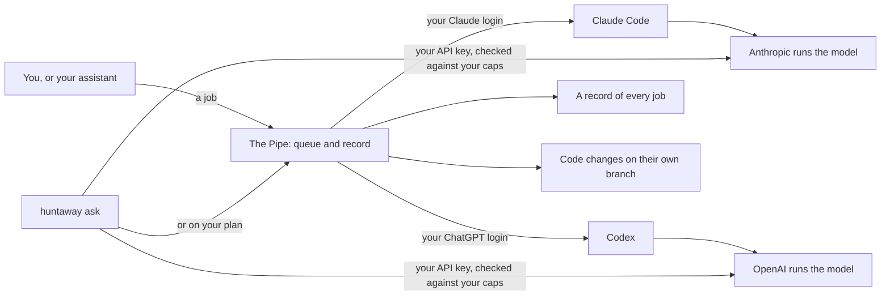

# Huntaway

**A job queue for Claude Code and Codex, on your own computer.**

Hand Huntaway coding tasks, in plain words through Claude Code or OpenClaw, or from the command line. It runs each one
through Claude Code or Codex, signed in as you. If your plan is full when a task's turn comes, the task waits for room
instead of failing at the start. Each task's changes go on their own branch, and each task leaves a record of what it
did. When you want a second opinion, a model from Anthropic and a model from OpenAI review the same commit.

And when you'd rather not wait for your plan, `huntaway ask` can send a question to Anthropic's or OpenAI's API with
your own key, inside dollar caps you set first.

[Website](https://wrk.dog/huntaway) · [Get started](#get-started) · [How it works](https://wrk.dog/huntaway/how-it-works) ·
[API keys and caps](#paid-api-keys) · [FAQ](https://wrk.dog/huntaway/faq)

Free and open source (Apache-2.0) · macOS and Linux · version 0.1.1 · No account with us, no telemetry, nothing sent to us.



Huntaway has two parts:

- **The Pipe** ([`pipe/`](pipe/)), a small local service. You send it work; it picks one of your accounts that has
  room, runs the job through that provider's official command-line tool (`claude` or `codex`) with that account's own
  login, and keeps a record of what happened.
- **The `huntaway` command**, which asks one question and tells you plainly what happened: it ran, it certainly didn't
  run (so you can send it again), or it may have run. It runs on the Pipe, or on your own API key.

Huntaway is built by the team behind [Wrk.Dog](https://wrk.dog), and it is one of the `wrkdog` working-dog tools.

## Your plan, or your API key

|  | On your plan, through the Pipe | On your API key, with `huntaway ask` |
|---|---|---|
| **What runs** | Coding jobs and questions, through Claude Code or Codex | One question, sent to Anthropic's or OpenAI's API |
| **What it costs** | Your Claude or ChatGPT plan's allowance, as if you ran the tool yourself (and Codex credits, only if you [turn them on](#what-it-is-not)) | Billed per call to your API account |
| **When there's no room** | The job waits for room instead of failing at the start; a limit reached mid-run can still end it | It refuses any call whose worst-case cost would go over your caps ([one exception](#paid-api-keys)) |
| **Good for** | The steady, heavy work | Quick questions, or when you'd rather pay per call than wait for your plan |

You choose for each question: `huntaway ask` uses your Anthropic API key by default, `--engine openai` uses your
OpenAI key, and `--engine pipe` runs the question on your plan instead. Huntaway never switches by itself, and the Pipe
never falls back to a paid API. Every paid call first prints what it may cost and what you've used in the last 24
hours. [How the caps work](#paid-api-keys).

## See it work

**1. You ask, in plain words.** In Claude Code, with the Huntaway skill installed:

```text
you    › Queue a Codex job to add input checks to the signup form, with tests.
Claude › Before I send it: it runs in ~/my-app, on Codex (gpt-6.1-sol, high effort), and changes the signup
         form and its tests on its own branch. Nothing gets merged. Go ahead?
you    › Yes.
```

The skill tells Claude Code to name the repository, the model and what will change, and to ask before any job that
changes code. It guides the assistant; it isn't a lock.

**2. The job waits for room if it needs to, runs, and leaves a card.** `pipe card <id>` says how it ended and where the
work is. An example card, as an excerpt with made-up ids:

```json
"kind": "code", "mutating": true, "state": "completed",
"attempts": [ { "n": 1, "host": "my-mac", "account": { "alias": "codex-a" }, "outcome": "completed" } ],
"saved": { "state": "saved", "branch": "pipe/00000000-0000-0000-0000-000000000000",
           "commit": "2222222222222222222222222222222222222222",
           "diff": { "files": 2, "insertions": 40, "deletions": 3 } }
```

The work is a commit on its own branch, in its own worktree, not your checkout. The card says `saved` only when it was
saved. Nothing is merged.

**3. Two companies' models review that commit.** An Anthropic model and an OpenAI model each read the exact commit,
read-only, and vote `APPROVE`, `REVISE` or `REJECT`. Each reviewer's findings (the file, the line and what's wrong)
are in its own result. When both approve the same commit, the change is approved: two AI models found nothing
blocking. You decide what to merge.

## What it does

- **Pipe jobs wait instead of failing at the start.** When your accounts are busy, a job waits in line until one has
  room. A limit reached after a job has started can still end it.
- **Every job leaves a record.** Which account ran it, on which model, how it ended, and where any changed files are,
  in a local SQLite file only you can read.
- **Code reviews by two companies' models.** A review is tied to one exact commit. Nothing is approved until both an
  OpenAI model and an Anthropic model approve that same commit, and each vote is recorded with a receipt. An approval
  means two AI models found nothing blocking; it is not a security audit or a promise that the code is correct, and
  you decide what to merge.
- **Builds stay out of your way.** A job that changes code works in its own git worktree and saves its result as a
  commit on its own branch.
- **It never picks a model for you.** Every Pipe job names its model and effort, and says why.

## What it is not

- It is for **one person's own accounts on one machine**. It is not a way to share or resell subscriptions, and it is
  not a way around a provider's usage limits. Use only accounts you hold yourself, and check each provider's terms on
  multiple accounts and automated use.
- **The Pipe never falls back to paid APIs.** Each job runs on the plan you signed in with. Only if you set
  `codexCredits` in the Pipe's config do Codex credits also count as room, after ordinary room. It is meant for credits
  you didn't buy (promotional ones, for example), but the Pipe can't tell those from credits you bought, so leave it
  off if you hold bought credits. (The `huntaway` command's default engine is different: it calls Anthropic's paid
  API with your own key, unless you choose `--engine pipe`.)
- **Gemini is not supported in this release.** A Gemini setting refuses to start, and a Gemini job is refused.

The Pipe only runs the official CLIs you installed and signed in to yourself, and it never handles your provider
logins. Its only other network use is a bare connection, carrying no data, to the provider's own host
(`api.anthropic.com` or `chatgpt.com`, port 443), to check it can be reached. The `huntaway` command's default engine
reads your Anthropic API key from the environment or your macOS keychain and sends it only to Anthropic.
With `--engine openai`, it reads your OpenAI API key from the environment or your macOS keychain and sends it only to OpenAI.

## Get started

**The quick way:** tell your coding assistant (Claude Code, Codex, or another that can run commands), "Read
[`SETUP-WITH-YOUR-ASSISTANT.md`](SETUP-WITH-YOUR-ASSISTANT.md) and set Huntaway up for me." It checks your computer,
tells you what Huntaway will do and asks before it changes anything. You do the sign-ins yourself. Or by hand:

1. **Set up the Pipe.** Follow [`pipe/README.md`](pipe/README.md): install it, give each account its own login folder,
   write a config and start the service. Its command line (`pipe`) and its MCP server work from there. If you install
   from npm or Homebrew, see "The Pipe from a package" below.
2. **Optionally, install the `huntaway` command** (below), on its own with an Anthropic or OpenAI API key, or pointed at the
   Pipe.

## The `huntaway` command

### What you need

- macOS or Linux (both tested; the Pipe is developed on macOS and tested on Ubuntu), with [Node.js](https://nodejs.org)
  22.18 or later and git.
- For the default engine, an Anthropic API key in `ANTHROPIC_API_KEY` or your macOS keychain, and the two
  spend caps below. Huntaway makes one free token-count call and one Messages API call per question, billed to your API account. With `--engine pipe`, questions run through the Pipe on your subscriptions
  instead.
- For `--engine openai`, an OpenAI API key in `OPENAI_API_KEY` or your macOS keychain, and the same two caps.
  Huntaway makes one free token-count call and one Responses API call per question, billed to your OpenAI account.

### Install

There are three ways. With npm or Homebrew, install the package, then set it up:

```sh
npm install -g @wrkdog/huntaway    # or: brew install wrkdog/tap/huntaway
huntaway setup --standalone --alias "My Mac"
huntaway key set anthropic         # macOS: enter your key with echo off
# On Linux, set ANTHROPIC_API_KEY in your environment.
export HUNTAWAY_MAX_USD_PER_QUESTION=1
export HUNTAWAY_MAX_USD_PER_DAY=10
huntaway doctor
```

`--alias` is the name this machine reports as (letters, digits, spaces, `_` and `-`). `--standalone` means Huntaway
runs on its own, with your API key. For a Router setup, use `huntaway setup --router --fleet-aliases nodeid=Name,...`
instead. `huntaway setup` keeps its choices in `~/.local/share/huntaway/npm-settings.json`, and each one applies only
when you haven't set that variable yourself. Running it again replaces all of them. A change of Node version needs no
new setup.

Huntaway doesn't run from where the package is installed. On first use, the package's code is copied, read-only, to
`~/.local/share/huntaway/app/npm-<version>` in a folder only you can read, and it runs from there. Every run checks
that copy against the package's checksums and refuses if they differ. A new package version makes its own copy.
`huntaway doctor` lists the older ones, and `huntaway uninstall` removes them. Homebrew brings its own current Node;
with npm, you need Node.js 22.18 or later.

**To uninstall:** run `huntaway uninstall` first, because the package can't do it for you, then remove the package
with `npm uninstall -g @wrkdog/huntaway` or `brew uninstall huntaway`. This removes the code copies and the settings
and keeps your history. Use `huntaway uninstall --purge-history` to delete the history too.

**Or from source:**

```sh
git clone https://github.com/wrkdog/huntaway.git
cd huntaway
sh scripts/install-local.sh --standalone --alias "My Mac"
```

Then enter your key, set the two caps and run `huntaway doctor`, as above. The installer copies the current commit,
read-only, to `~/.local/share/huntaway/app` and adds a `huntaway` command to `~/.local/bin`. It uses no network and no
sudo, and writes nothing outside your home folder. If `~/.local/bin` isn't on your `PATH` (it isn't on a new Mac), the
installer says so: add it, or run `~/.local/bin/huntaway`.

Run the installer again after `git pull` to update. `sh scripts/uninstall-local.sh` removes the command and the code
and keeps your history. Add `--purge-history` to delete the history too.

### The Pipe from a package

The npm and Homebrew packages include the Pipe, so its commands are `pipe …` and `pipe-mcp`. Follow
[`pipe/README.md`](pipe/README.md) from "Set up accounts", using `pipe` wherever it runs `node src/cli.ts`. Its shell
function becomes `pipe() { command pipe "$@" --config /absolute/path/to/pipe-data/config.json; }`. Its
`config.example.json` is in the package's `pipe/` folder.

**MCP:** write the small `pipe-mcp` script from that README, with the command's absolute path on its last line.
`echo "$(npm prefix -g)/bin/pipe-mcp"` prints that path with npm, and `echo "$(brew --prefix)/bin/pipe-mcp"` with
Homebrew:

```sh
#!/bin/sh
export PIPE_URL=http://127.0.0.1:8123
PIPE_TOKEN="$(cat /absolute/path/to/pipe-data/pipe.token)"; export PIPE_TOKEN
exec "/absolute/path/to/bin/pipe-mcp"
```

Make it executable, and register the script's own absolute path:

```sh
claude mcp add --scope user pipe -- /absolute/path/to/your/pipe-mcp-script
```

The script carries the settings: `huntaway ask --engine pipe` reads only the command and its arguments from Claude
Code's settings, not `-e` flags. With npm, `pipe-mcp` finds `node` through `PATH`, so whatever starts the script needs
`node` on its `PATH`.

**LaunchAgent:** use that README's plist with different `ProgramArguments`. An npm command starts with
`#!/usr/bin/env node`, which can't find `node` under launchd's minimal `PATH`, so name both files by their absolute
paths:

```xml
<key>ProgramArguments</key><array>
  <string>/absolute/path/to/node</string><string>/real/path/to/npm/pipe.mjs</string>
  <string>serve</string><string>--config</string><string>/absolute/path/to/pipe-data/config.json</string>
</array>
```

`command -v node` prints the first. This prints the second:

```sh
node -p 'fs.realpathSync(process.argv[1])' "$(npm prefix -g)/bin/pipe"
```

With Homebrew, its `pipe` command already names its own Node, so the first entry can be that command's absolute path
(`echo "$(brew --prefix)/bin/pipe"` prints it), then `serve`, `--config` and the rest.

### Use

```sh
huntaway ask "What is the capital of Australia?"
echo "a private question" | huntaway ask -      # kept out of the process list other users can see
huntaway ask - < question.txt                    # and, from a file, out of your shell history too
huntaway ask -- "-5 degrees: is that cold?"      # a question starting with a dash
huntaway status                                  # this machine and its runs
huntaway status --json                           # the same, for a program
```

For `ask` with the default engine, `--model` picks the model (default `claude-sonnet-5-5`), `--max-tokens` caps the
answer (default 1024, at most 8192), and `--timeout` limits the wait in seconds (default and at most 300, Huntaway's
own cap covering the count and the unstreamed answer). The count also has its own 30-second limit.
With `--engine openai` (or `HUNTAWAY_ENGINE=openai`), the default model is `gpt-5.4`, with reasoning effort set to
`none`. OpenAI accepts `--max-tokens` from 16 to 8192 (Anthropic accepts 1 to 8192); a value outside that range
is a usage error before anything is sent. The same `--timeout` limits apply. `--family` and `--effort` are usage
errors for OpenAI.

### Paid API keys

Anthropic and OpenAI are the paid API engines in this release. Each sends your question to its provider twice:
first to count tokens (free), then to get an answer. Anthropic keeps its own records under its own terms. The Pipe
continues to use your subscriptions.

`store: false` means OpenAI doesn't store the response for later retrieval. OpenAI still keeps its own records under
its terms, including abuse-monitoring logs for up to 30 days by default.

A nonempty `ANTHROPIC_API_KEY` takes precedence. An invalid value refuses without falling back. On macOS, if the
variable is unset or empty, Huntaway reads your keychain (service `huntaway`, account `anthropic`), in the keychains
macOS searches by default (normally just the login keychain). A missing, locked or unreadable keychain refuses. On Linux, use the environment.
For OpenAI, the same rules use `OPENAI_API_KEY` and keychain account `openai`; the key goes only to OpenAI.

Run `huntaway key set anthropic` to enter a key with terminal echo off, or supply one line on stdin from a secret
manager. `huntaway key remove anthropic` removes the stored item. Huntaway never writes your API key to a file;
`huntaway key set` stores it in your default keychain, normally the login keychain. Any program running as you can read that item without a prompt:
its exposure is the same as an environment variable. Huntaway never puts it in a log, a run record, the spend ledger,
an error or a command's arguments. `huntaway doctor` reports its source, never its value.
Use `huntaway key set openai` and `huntaway key remove openai` for the OpenAI key.

Both `HUNTAWAY_MAX_USD_PER_QUESTION` and `HUNTAWAY_MAX_USD_PER_DAY` are required dollar amounts from 0.01 to 1000,
with up to two decimal places; the day cap must be at least the question cap. Both apply to the **hard worst case**:
the hard input and your output limit at the table's standard prices, including applicable surcharges. Every call
pins the standard tier. For a model with the byte bound, hard input is the smaller of its hard input limit and
2 × B + its fixed overhead. B is the larger of the exact billed JSON request body's UTF-8 byte length and the same
body's byte length with the question NFKC-normalized. Huntaway sends the question unchanged; normalization is only
for counting. Without the byte bound, hard input is the hard input limit. The counted estimate is information only.
These caps cover only Huntaway's own use on this machine, under
this `HUNTAWAY_HOME`, not your provider account as a whole. The cap grows with the question. A **10,240-byte request
body** with default `--max-tokens 1024` on `claude-sonnet-5-5` needs a per-question cap of **$0.06** (56,461
micro-dollars, rounded up to the cent), with B = 10,240 after taking the larger count. On OpenAI's default `gpt-5.4`,
the same body and output limit need a per-question cap of **$0.13** (125,760 micro-dollars, rounded up to the cent).
Doctor uses these same examples; a refusal names the cap your request needs. Larger questions need more.
Anthropic's standard table prices are $2.20 / $11 per million tokens, including the possible 10% US-residency surcharge;
the hard input limit is 1,000,000 tokens and the conservative framing overhead is 64 tokens.
OpenAI's table uses $5 / $22.50 per million tokens, the highest standard rates including the long-context premium,
even for short questions. Its hard input ceiling is the full 1,050,000-token context window, with a conservative
64-token framing overhead; output may stop at the context boundary. Its byte bound uses OpenAI's published
`o200k_base` byte-level BPE tokenizer. The
non-standard tier allowance is conservatively $25 / $112.50 per million tokens; no current public GPT-5.4
Fast/priority long-context price was confirmed. These numbers were checked on 2026-11-05 against the
[model documentation](https://developers.openai.com/api/docs/models/gpt-5.4) and
[pricing documentation](https://developers.openai.com/api/docs/pricing).

The byte-bound basis is Anthropic's [earlier published byte-level BPE tokenizer](https://github.com/anthropics/anthropic-tokenizer-typescript).
It applies NFKC normalization before encoding, which can expand text: U+FDFA grows from 3 UTF-8 bytes to 33.
Counting the normalized question in the same JSON body covers that expansion; taking the larger count also covers
text that normalization shrinks.
Anthropic hasn't published this model's tokenizer. The defences are the factor 2 margin and the post-call overrun
block: billed input above the hard input bound stops further calls to that model, even if its cost fits the
reservation. If the table is wrong or the provider ignores the pinned tier, that one call can pass a cap; it warns
and blocks the model. A missing or non-standard reported tier settles at the priority price as an overrun. The
priority allowance is conservatively $11 / $55 per million tokens because no public Sonnet 5.5 rate was confirmed.
Choose a cheaper table model when one is available, or raise the cap; a lower estimate cannot admit the request.

A price override such as `HUNTAWAY_PRICE_ANTHROPIC_CLAUDE_SONNET_5_5=12,60` can only raise table prices for a known
model. Prices are dollars per million tokens, up to six decimal places, from 0 to 1000. Doctor flags overrides and
tables checked more than 60 days ago. Missing or invalid usage retains the full reservation. A spend overrun warns
and blocks that model until a reviewed safety revision fixes its prices, limits or reader; updating an unrelated
model or installing an older release cannot clear it. An answer that was printed still exits 0.

The day is a rolling **last 24 hours**, based on UTC start times, with future-dated rows counted too. There is no
local midnight reset. The ledger trusts your system clock: moving it backwards adds rows to the window; moving it
forwards can free headroom early. A clock far in the past holds future-dated spending until it catches up. Correct
the clock to recover. The caps guard against accidents, not against their owner. `uninstall-local.sh --purge-history`
(`huntaway uninstall --purge-history` from a package) is an uninstall that deletes the whole ledger, including every
overrun block. `huntaway status` and doctor show
spend; an uncertain request keeps its reservation, and concurrent questions reserve under a database lock.

Each paid question prints two lines on stderr. Before sending even the count, the first says:

```text
This question uses your paid Anthropic API key; any charge goes to that account. Huntaway first asks Anthropic to count the question (free), which sends it to Anthropic. Caps: $1.00 a question, $10.00 a day (Huntaway's own use on this machine).
```

It adds `A price override is in use.` when applicable. After counting and reserving, before the billed call, the
second looks like this for the 10,240-byte body above (the estimate and prior spend vary):

```text
At most $0.06 for this question (about $0.0175 by Anthropic's count); $0.02 of your $10.00 used in the last 24 hours.
```

“At most” rounds the hard ceiling up to cents; “about” is only an estimate; “used” excludes this question's own
reservation. If the ledger cannot be opened, read or locked in five seconds, nothing billed is sent. A failed count
also sends nothing billed. Neither call is retried, and redirects are refused.

### Through the Pipe

With the Pipe running and its MCP server registered with `claude mcp add --scope user pipe -- <command>` (see
[`pipe/README.md`](pipe/README.md), "MCP"), `huntaway ask --engine pipe "..."` runs the question on your subscriptions
through the Pipe. `--family claude|codex` chooses which (default `claude`).
The model defaults to `opus` for Claude and `gpt-6.1-sol` for Codex.
`--effort low|medium|high` sets the effort (default `medium`), and `--timeout` defaults to 600 seconds. `--max-tokens`
is for paid API engines only, and `--effort` for the Pipe only: either one with the other engine is a usage error.
To make the Pipe your default engine, set `HUNTAWAY_ENGINE=pipe`. You can also name the MCP command yourself in
`HUNTAWAY_PIPE_CMD`, as a JSON array. Huntaway never switches engines by itself.

### From OpenClaw

[`openclaw/huntaway/SKILL.md`](openclaw/huntaway/SKILL.md) is a skill for an [OpenClaw](https://openclaw.ai)
assistant: with the Pipe's MCP server added to an OpenClaw node, the assistant can hand jobs to Claude Code or Codex,
watch them and ask for reviews by two companies' models. It tells the assistant to ask you before any job that
changes code and never to push or merge. Those rules guide the assistant; they are not a lock, so connect the Pipe
only to an assistant that only you can talk to. The skill is also published on ClawHub, where every skill is under
the MIT-0 licence.

### From Claude Code (and other assistants)

[`skills/huntaway/SKILL.md`](skills/huntaway/SKILL.md) is a Claude Code skill with the same rules and tasks, for the
Pipe's MCP tools. [`SETUP-WITH-YOUR-ASSISTANT.md`](SETUP-WITH-YOUR-ASSISTANT.md) installs it on your yes. Any other
assistant can read it as its instructions.

### What each outcome means

| You see | In `status` | What it means |
|---|---|---|
| The answer | `done` | It ran and you have the answer. |
| "Nothing ran; you can send it again." | `failed` | The API refused it, or couldn't be reached. It certainly didn't run. |
| "It may have run and was not retried." | `uncertain` | The call was sent but the answer was lost (a server error, a dropped connection, the time limit). Check before sending again. |
| "Stopped before anything was sent." (you pressed Ctrl-C) | `failed`, `declined` or `cancelled` | Stopped before the call was sent. It never ran. |
| "Stopped. It may have run" (you pressed Ctrl-C) | `uncertain` | Stopped after the call was sent. |

If Huntaway itself is cut off (a crash or a power cut), the next `huntaway ask` records that run: `declined` or
`cancelled` if it was never sent, `uncertain` if it may have been. While a question is in flight, `status` shows it
as `waiting_local_host` or `running`. With the default engine, the `huntaway` command never resends a question on
its own, so it can't run twice without you knowing. (With `--engine pipe`, the Pipe may retry a job within the limits
its README describes.)

### What it keeps

In `~/.local/share/huntaway`, in files only you can read:
- the request log (`requests.db`);
- the run list (`runs.db`);
- the spend ledger (`spend.sqlite`), with start time, engine, model and safety revision, estimated and reserved
  micro-dollars, settled cost and validated tokens when available, outcome and overrun flag;
- a per-install key (`key`), used only to fingerprint questions.

The spend ledger never holds a key, question, answer or request id. Rows older than 24 hours may be pruned; overrun
rows are kept at every age. `--purge-history` removes the ledger and its side files along with the other history.
Set `HUNTAWAY_HOME` to choose another data folder (this also gives it a separate cap ledger).

Each `huntaway ask` removes up to 100 ended runs that started more than 90 days ago (a run active since then stays),
plus up to 100 runs a crash left without their request, once they too are older than that, so the files stop growing
(they do not shrink). Set `HUNTAWAY_KEEP_DAYS` (whole days, 1 to 3660; empty means 90) to keep more or less; any other
value keeps everything, with a warning. A run still in progress, or one without a time Huntaway wrote, is never
removed, and nothing is removed while either file is a link to another file or isn't yours.

The `huntaway` command itself never stores your questions or answers, only a keyed fingerprint of each question. Your
API key is read from the environment or your macOS keychain and sent only to the chosen provider's API:
Anthropic for `--engine anthropic`, OpenAI for `--engine openai`. Each keeps its own records under its own terms,
including OpenAI's records described under "Paid API keys" above. With `--engine pipe`, the Pipe's own record keeps
each job's prompt and result, and the provider CLI keeps its own history.

### If the request log needs recovery

Huntaway refuses to open its request log if an earlier run stopped part-way through creating or writing it, for
example when the power failed during your very first `ask`. It won't guess what the log held, because a guess could
hide a question that may have run. Keep every file in the folder as it is, make sure no `huntaway` is running, and
open an issue (without attaching the files).

### Status as JSON

`huntaway status --json` prints a snapshot in a small, stable shape: this machine and its runs, as codes rather than
words. The schema and examples are in the `contract/` folder.

## Known issues

- **Several `huntaway ask` runs started close together, most often on a brand-new install,** can, rarely, stop with
  "Error: the request log could not be opened". A run that stops this way has sent nothing: run that one again.
- **An existing global `pipe` command from another package** makes `npm install -g @wrkdog/huntaway` fail with
  `EEXIST`.
- **From a package, a signal sent only to the launcher's process doesn't always reach Huntaway.** A SIGINT or SIGHUP
  sent to just that process (`kill -INT <pid>`) doesn't reach the running command; SIGTERM does. Ctrl-C and a closed
  terminal aren't affected, because they reach both.
- **From a package, a SIGTERM sent to the whole process group reaches the running command twice:** once directly, and
  once forwarded. `huntaway ask` may stop while it is settling, and the next `huntaway ask` records that run honestly.
- **From a package, `nohup pipe serve` doesn't keep the Pipe running after a hangup.** Node resets ignored signals in
  the process it starts, so the Pipe still gets the SIGHUP. Run it as a LaunchAgent on macOS (see "The Pipe from a
  package" above) or a systemd user service on Linux, as [`pipe/README.md`](pipe/README.md), "Run it as a service",
  shows. A source install isn't affected.
- **The app's own hints still say "install with --alias NAME".** From a package, that means `huntaway setup --alias
  NAME`.
- **The app's own hints still say "install with --fleet-aliases".** From a package, that means `huntaway setup --router
  --fleet-aliases LIST`.

## Contributing and security

See [CONTRIBUTING.md](CONTRIBUTING.md). To report a vulnerability privately, see [SECURITY.md](SECURITY.md). Please
don't open a public issue for it. For conduct, see [CODE_OF_CONDUCT.md](CODE_OF_CONDUCT.md).

## License

Apache License 2.0. See [LICENSE](LICENSE) and [NOTICE](NOTICE). `openclaw/huntaway/SKILL.md` is also offered under
MIT-0, as ClawHub requires of every skill it publishes.

## Trademarks

Huntaway is an independent project. It is not made, endorsed or supported by Anthropic or OpenAI. Anthropic, Claude,
Claude Code, OpenAI, ChatGPT and Codex are trademarks of their owners, named here only to say which tools Huntaway
runs.
